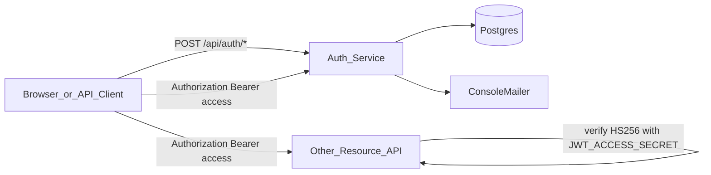
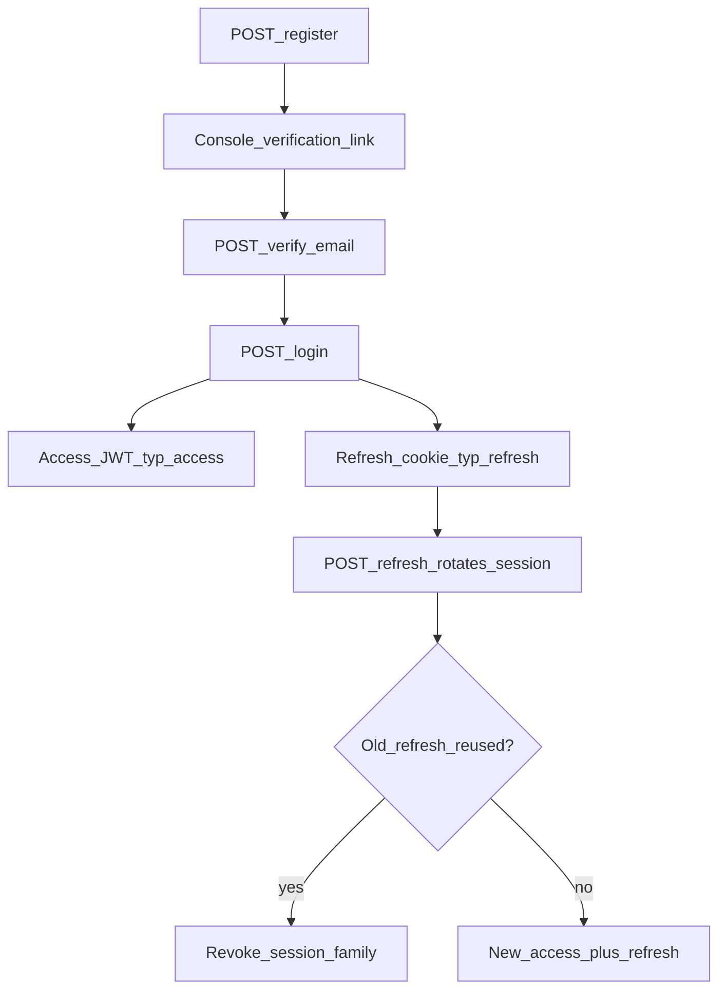
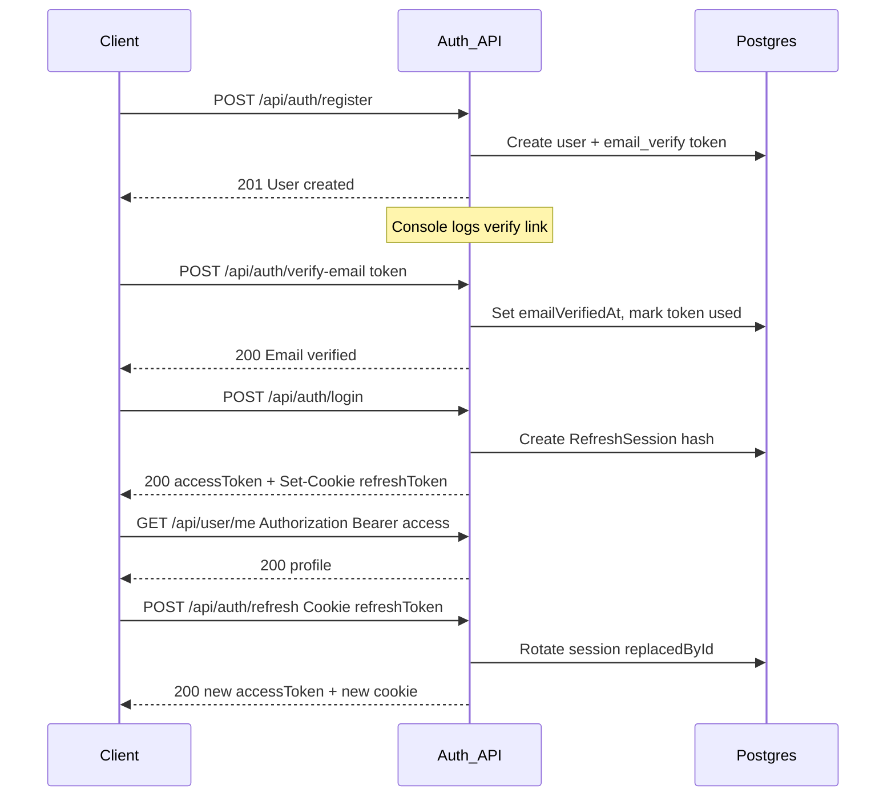
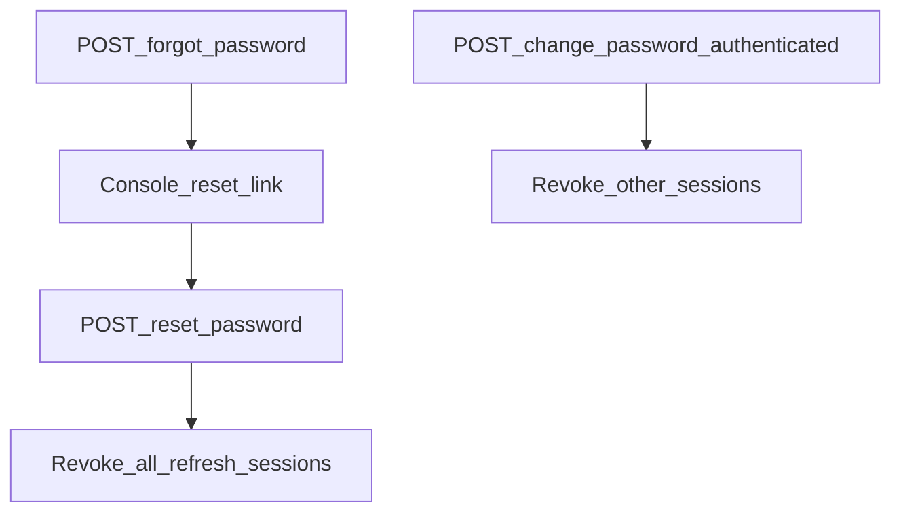

# Auth Service

Standalone authentication API built with **Fastify**, **Prisma**, and **PostgreSQL**.  
It issues short-lived **access JWTs** (Bearer) and long-lived **refresh tokens** (HttpOnly cookie), with email verification and password recovery via a pluggable console mailer.

---

## Architecture



| Piece | Role |
|-------|------|
| Access JWT | Short-lived (`typ: access`), returned in JSON, sent as `Authorization: Bearer` |
| Refresh JWT | Long-lived (`typ: refresh`), HttpOnly cookie `refreshToken`, path `/api/auth` |
| RefreshSession | DB row storing **hashed** refresh token + rotation chain (`replacedById`) |
| OneTimeToken | Hashed tokens for `email_verify` / `password_reset` |
| Mailer | Interface + console adapter (logs links; swap later for SMTP/Resend) |

**Signing keys are separated:** access uses `JWT_ACCESS_SECRET`, refresh uses `JWT_REFRESH_SECRET`.

---

## Account & session workflow



### Cookie + Bearer flow (happy path)



### Refresh reuse detection

If a **already rotated** refresh token is presented again (`replacedById` set), the service treats that as theft signal and revokes the **entire session chain**, then returns `401`.

### Logout

`POST /api/auth/logout` uses the **refresh cookie only** (no valid access token required). It revokes the matching session and clears the cookie.

---

## Password recovery



Forgot / resend responses are **opaque** (same message whether or not the email exists).

---

## API overview

### Health
| Method | Path | Auth |
|--------|------|------|
| GET | `/health` | — |
| GET | `/ready` | — (DB check) |

### Auth — `/api/auth`
| Method | Path | Auth | Notes |
|--------|------|------|-------|
| POST | `/register` | — | Rate-limited; sends verify link |
| POST | `/login` | — | Requires verified email; sets refresh cookie |
| POST | `/refresh` | Cookie | Rotates refresh; reuse → revoke family |
| POST | `/logout` | Cookie | Works with expired access token |
| POST | `/verify-email` | — | Body: `{ "token" }` |
| POST | `/resend-verification` | — | Body: `{ "email" }` |
| POST | `/forgot-password` | — | Body: `{ "email" }` |
| POST | `/reset-password` | — | Body: `{ "token", "password" }` |
| POST | `/change-password` | Bearer | Body: `{ "currentPassword", "newPassword" }` |

### Sessions — `/api/sessions`
| Method | Path | Auth |
|--------|------|------|
| GET | `/` | Bearer — list active sessions |
| DELETE | `/:id` | Bearer — revoke one |
| DELETE | `/` | Bearer — revoke all **other** sessions |

### User — `/api/user`
| Method | Path | Auth |
|--------|------|------|
| GET | `/me` | Bearer |
| PATCH | `/name` | Bearer |
| DELETE | `/me` | Bearer |

**Password rules (register / reset / change):** min 8 characters, at least one letter and one digit.

---

## Environment variables

Copy [`.env.example`](.env.example) to `.env`.

| Variable | Purpose |
|----------|---------|
| `NODE_ENV` | `development` \| `production` \| `test` |
| `HOST` / `PORT` | Listen address |
| `POSTGRES_*` | Database connection (builds `DATABASE_URL`) |
| `JWT_ACCESS_SECRET` | HMAC secret for access tokens (**must differ** from refresh) |
| `JWT_REFRESH_SECRET` | HMAC secret for refresh tokens |
| `JWT_ACCESS_EXPIRES_IN` | e.g. `15m` |
| `JWT_REFRESH_EXPIRES_IN` | e.g. `7d` |
| `CORS_ORIGIN` | Comma-separated allowlist (required with credentials) |
| `APP_PUBLIC_URL` | Base URL for verify/reset links (usually the frontend) |

Generate strong secrets for production, for example:

```bash
openssl rand -base64 48
```

---

## Local development

```bash
# 1. Env
cp .env.example .env
# edit secrets if needed

# 2. Database
docker compose up -d

# 3. Migrate + generate client
npx prisma migrate deploy
npx prisma generate

# 4. Run API
npm install
npm run dev
```

- App: `http://127.0.0.1:3000`
- Health: `GET /health`
- Interactive OpenAPI docs: `http://127.0.0.1:3000/docs`
- Verification / reset links are printed in the **server console** by `ConsoleMailer`

```bash
npm run typecheck
npm run build && npm start
```

---

## How another API verifies access tokens (HMAC)

Other services that trust this auth issuer can validate **access** tokens without calling this API on every request:

1. Share **only** `JWT_ACCESS_SECRET` (never the refresh secret).
2. Verify with the same algorithm Fastify JWT defaults to (**HS256**).
3. Enforce claims:
   - `typ === "access"`
   - `exp` not expired
   - use `sub` as the user id

Example with Node `jsonwebtoken`:

```js
import jwt from 'jsonwebtoken';

function requireAccess(authorizationHeader) {
  const [scheme, token] = (authorizationHeader || '').split(' ');
  if (scheme !== 'Bearer' || !token) throw new Error('Unauthorized');

  const payload = jwt.verify(token, process.env.JWT_ACCESS_SECRET, {
    algorithms: ['HS256'],
  });

  if (payload.typ !== 'access') throw new Error('Unauthorized');
  return { userId: payload.sub, email: payload.email };
}
```

Do **not** accept refresh tokens on resource APIs. Refresh stays cookie-bound to `/api/auth` on this service.

Later phases may move access verification to **JWKS / asymmetric** keys; today it is shared-secret HMAC.

---

## Security notes (Phase 1)

- Dual secrets + `typ` claim (defense in depth)
- Refresh tokens stored hashed; rotated on every `/refresh`
- Refresh reuse → revoke session family
- Rate limits on register / login / refresh / verify / reset paths
- CORS allowlist via `CORS_ORIGIN`
- Login blocked until email verified

**Not in Phase 1:** JWKS, MFA, OAuth, real SMTP, RBAC, audit UI.

---

## Project layout

```
src/
  app.ts                 # Fastify app, plugins, routes
  config/env.ts          # Zod-validated env
  plugins/               # prisma, auth (JWT helpers), mailer
  modules/
    auth/auth.service.ts # Auth + sessions routes
    users/users.service.ts
    mail/mailer.ts       # Mailer interface + console adapter
prisma/                  # Multi-file schema + migrations
```
